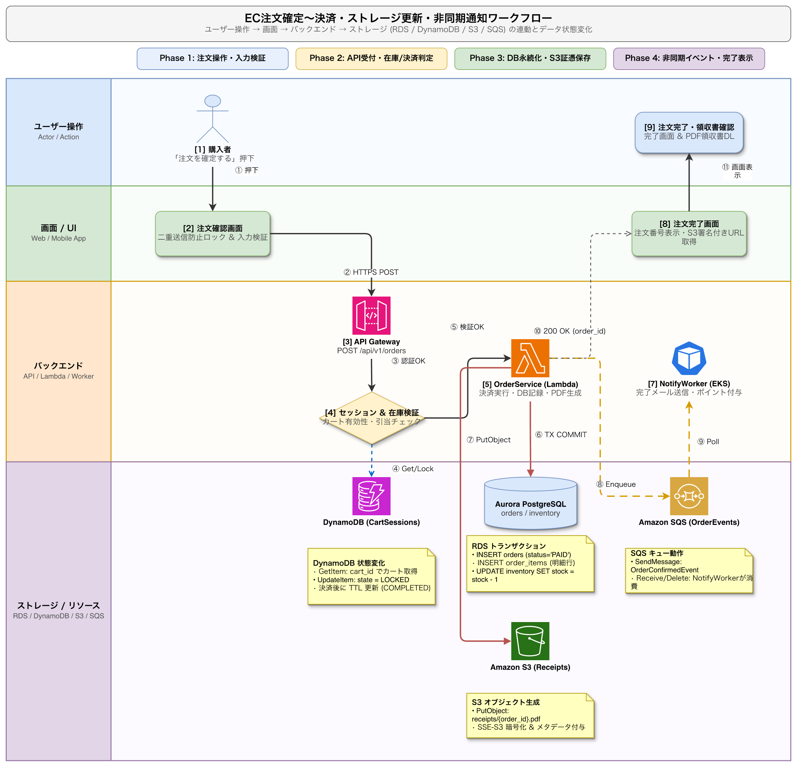
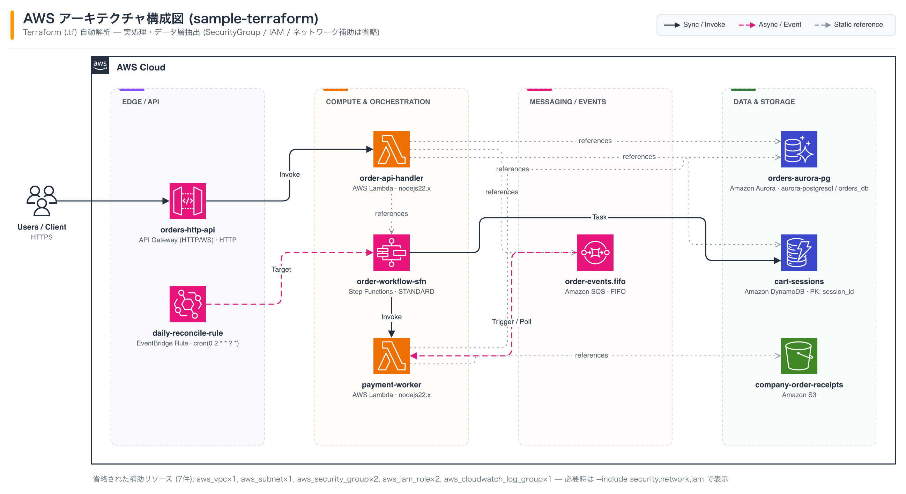
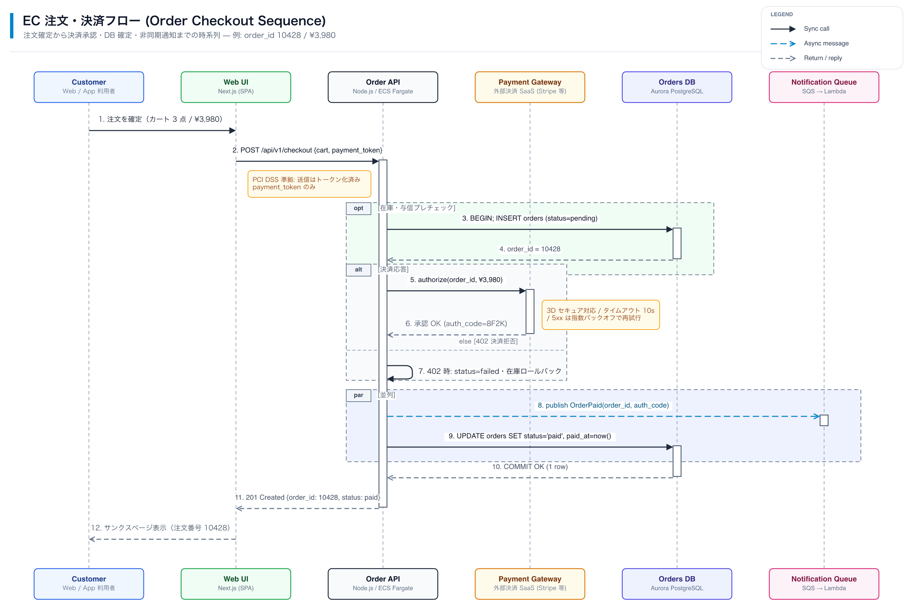
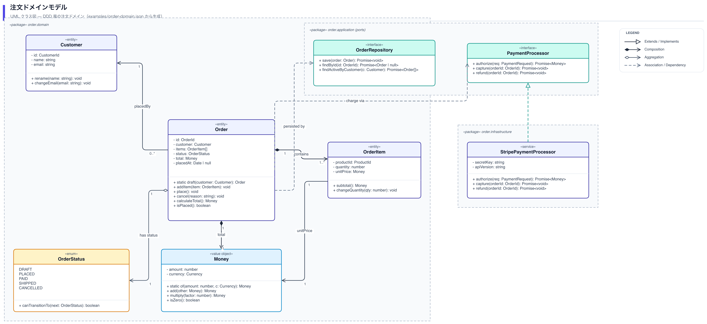
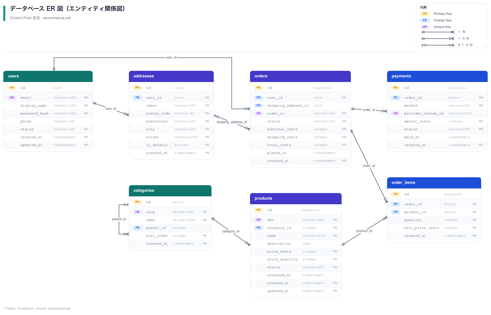
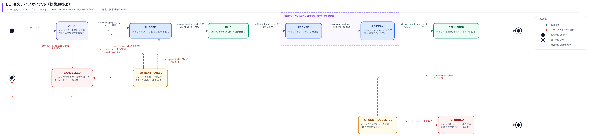
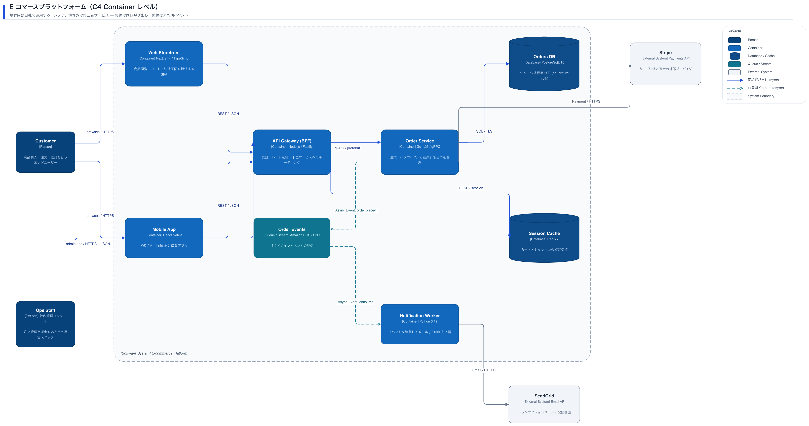
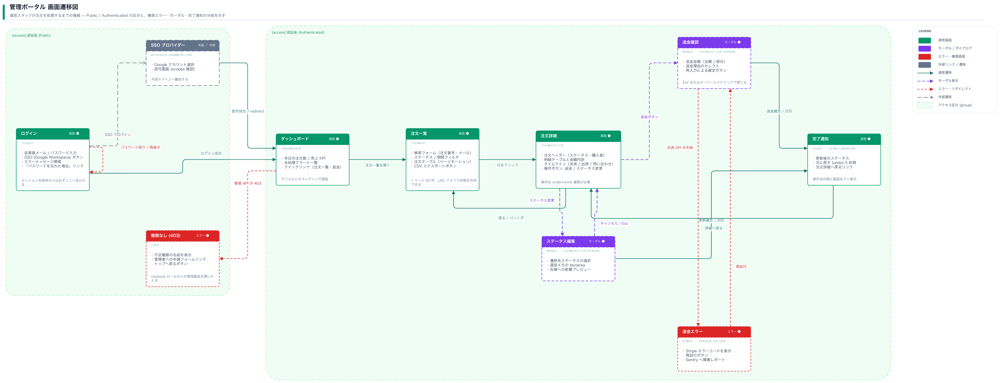

# drawio-diagrams-skill

**8 種類の draw.io 図面**を、ゼロ依存の Node.js (.mjs) だけで `.drawio` XML と
**XML 埋め込み済み `.drawio.png`**（画像として貼れるうえ draw.io で開いて再編集可能）として
生成する統合エージェントスキルです。`npm install` も draw.io アプリもブラウザも不要です。

| 図種別 | 入力 | 生成スクリプト |
|---|---|---|
| スイムレーン業務フロー図 | JSON spec（方向・レーン・ノード・エッジ） | `scripts/build-workflow.mjs` |
| AWS アーキテクチャ構成図 | Terraform `.tf` 静的解析 | `scripts/build-aws-arch.mjs` |
| UML シーケンス図 | JSON spec（参加者・メッセージ・alt/loop） | `scripts/build-sequence.mjs` |
| UML クラス図 | JSON spec / TS・JS ソーススキャン | `scripts/build-class.mjs` |
| Crow's Foot ER 図 | SQL DDL / Prisma スキーマスキャン | `scripts/build-er.mjs` |
| UML 状態遷移図 | JSON spec（状態・遷移・ガード・複合状態） | `scripts/build-state.mjs` |
| C4 Container 図 | JSON spec（人・要素・境界・関係） | `scripts/build-c4.mjs` |
| 画面遷移図 | JSON spec（画面・ルート・遷移・モーダル） | `scripts/build-screen-flow.mjs` |

全ビルダーは共通エンジン [scripts/drawio2png.mjs](scripts/drawio2png.mjs) で
`.drawio → .drawio.png / .svg` 変換を行います。`drawio2png.mjs` はローカルファイルの
import を一切持たない単一ファイル完結の Pure Node.js コンバーターで、この 1 ファイルだけを
コピーしても動作します（ビルダー側が共有する小さな補助モジュール
[scripts/diagram-shared.mjs](scripts/diagram-shared.mjs) は変換器とは別に必要です）。
エージェント向けの薄いルーター定義は [SKILL.md](SKILL.md)、図ごとの詳細仕様は [references/](references/) にあります。
シンボル・ステンシル・矢印マーカーの在庫一覧と手書き XML レシピは
[references/catalog-and-stencils.md](references/catalog-and-stencils.md) です。

## 1 コマンド導入

```bash
git clone <このリポジトリの URL> ~/.agents/skills/drawio-diagrams && cd $_ && npm run demo
```

（依存インストール工程はありません。`npm run demo` は Node.js だけで 8 種の PNG を生成します。）

生成物を壊していないことの確認も Node 標準ライブラリだけでできます（`npm test` は `node --test` を実行するだけです）。

```bash
npm test
```

## サンプル出力（`npm run demo` で生成される 8 種）

| 業務フロー（横スイムレーン） | AWS 構成図（Terraform から） |
|---|---|
|  |  |
| **UML シーケンス図** | **UML クラス図** |
|  |  |
| **ER 図（Crow's Foot）** | **UML 状態遷移図** |
|  |  |
| **C4 Container 図** | **画面遷移図** |
|  |  |

## CLI 使用例

すべてのサブコマンドは統合ディスパッチャ `scripts/drawio-cli.mjs` 経由で実行します
（`--help` で 8 つの図種サブコマンドと `png` / `shapes` を一覧表示）。
`shapes` は `shape=` に書けるシェイプ名・ステンシル名・矢印マーカー名を検索する読み取り専用コマンドです。

```bash
# サブコマンド一覧
node scripts/drawio-cli.mjs --help

# 1. スイムレーン業務フロー図（縦方向にも切替可）
node scripts/drawio-cli.mjs workflow \
  --spec examples/workflow/order-checkout-workflow.json \
  --direction horizontal \
  --output examples/output/workflow-horizontal.drawio.png

# 2. Terraform → AWS 構成図（SG / IAM 等はデフォルト省略）
node scripts/drawio-cli.mjs aws-arch \
  --tf-dir examples/aws-arch/sample-terraform \
  --output examples/output/aws-arch-default.drawio.png

# 3. UML シーケンス図
node scripts/drawio-cli.mjs sequence \
  --spec examples/sequence/order-checkout.json \
  --output examples/output/order-checkout-sequence.drawio.png

# 4. UML クラス図（--src-dir <src> で TS/JS を直接スキャンも可）
node scripts/drawio-cli.mjs class \
  --spec examples/class/order-domain.json \
  --output examples/output/order-domain-class.drawio.png

# 5. SQL DDL / Prisma → ER 図
node scripts/drawio-cli.mjs er \
  --schema examples/er/sample-schema/ecommerce.sql \
  --output examples/output/ecommerce-er.drawio.png \
  --json-out examples/output/ecommerce-er.json

# 6. UML 状態遷移図（event [guard] / action ラベル・複合状態・ガード分岐）
node scripts/drawio-cli.mjs state \
  --spec examples/state/order-lifecycle.json \
  --output examples/output/order-lifecycle-state.drawio.png

# 7. C4 Container 図（人・自社境界・外部 SaaS・DB / キューの形状分け）
node scripts/drawio-cli.mjs c4 \
  --spec examples/c4/ecommerce-container.json \
  --output examples/output/ecommerce-c4-container.drawio.png

# 8. 画面遷移図（モーダル / エラー / 外部離脱の分岐、アクセス権グループ）
node scripts/drawio-cli.mjs screen-flow \
  --spec examples/screen-flow/admin-portal.json \
  --output examples/output/admin-portal-screen-flow.drawio.png

# 共通: 既存 .drawio の変換・XML 抽出・レイアウト検査
node scripts/drawio-cli.mjs png diagram.drawio -o diagram.drawio.png --scale 2 --embed-xml
node scripts/check-layout.mjs diagram.drawio
```

## 同梱のステンシルとシンボル（オフラインで使える実測値）

`scripts/drawio2png.mjs` は draw.io OSS のシェイプ定義を単一ファイルに埋め込んでおり、
ネットワーク接続なしで次の描画資産が使えます（数値は `getDrawioOssRuntime()` の実測）。

| 資産 | 実測数 | 例 |
|---|---|---|
| 既定シェイプ（遅延ロード不要） | **772**（`mxgraph.*` 680 + プリミティブ 92） | `cylinder3` `swimlane` `umlActor` `rhombus` `startState` `endState` `note` |
| 遅延ロード・ステンシルライブラリ | **42 ライブラリ / 48 ファイル / 4,095 シェイプ** | `aws4` 1037、`cisco_safe` 485、`gcp2` 297、`cisco19` 232、`kubernetes` 79、`bpmn` 39、`eip` 36、`flowchart` 34 |
| 矢印マーカー（`endArrow` / `startArrow`） | **32** | `block` `open` `async` `diamondThin` `ERmandOne` `ERmany` `sysMLProvInt` |
| ペリメータ / エッジスタイル | **14** / **8** | `RhombusPerimeter` `LifelinePerimeter` / `orthogonalEdgeStyle` `entityRelationEdgeStyle` |

```bash
# 例: 埋め込みステンシルを直接指定して描く（色を明示すると確実）
#   shape=mxgraph.kubernetes.pod;fillColor=#326CE5;strokeColor=none;
#   shape=mxgraph.gcp2.bigquery;fillColor=#4285F4;
#   shape=mxgraph.aws4.resourceIcon;resIcon=mxgraph.aws4.lambda;fillColor=#ED7100;
node scripts/drawio-cli.mjs png my-diagram.drawio -o my-diagram.drawio.png
```

一覧の全量・手書き XML の最小テンプレート・GCP / Kubernetes / BPMN / ネットワーク図の
スタイル断片は [references/catalog-and-stencils.md](references/catalog-and-stencils.md) にまとめてあります。

## ディレクトリ構成

```text
drawio-diagrams-skill/
├── SKILL.md                  # 薄いルーター型スキル定義（図種別ルーティング表）
├── references/               # 図ごとの詳細ガイド（段階的開示）
│   ├── workflow.md  aws-arch.md  sequence.md  class.md  er.md
│   ├── state.md  c4.md  screen-flow.md
│   └── catalog-and-stencils.md   # 8 種カタログ + シンボル / ステンシル実測一覧
├── scripts/
│   ├── drawio-cli.mjs        # 統合 CLI ディスパッチャ（10 サブコマンド＋ shape 検索）
│   ├── drawio2png.mjs        # 共通コンバーター（全ビルダー共有・単一ファイル）
│   ├── check-layout.mjs      # 配置・重なり検査
│   ├── build-workflow.mjs    scan-terraform.mjs   build-aws-arch.mjs
│   ├── build-sequence.mjs    scan-classes.mjs     build-class.mjs
│   ├── build-er.mjs          scan-schema.mjs
│   ├── build-state.mjs       build-c4.mjs         build-screen-flow.mjs
│   └── diagram-shared.mjs    # 共通の XML エスケープ / セル ID 採番 / 出力パス検査 / 書き出し手順
├── tests/
│   └── regression.test.mjs   # node:test による回帰テスト（依存パッケージなし）
└── examples/
    ├── workflow/  aws-arch/sample-terraform/  sequence/  class/  er/sample-schema/
    ├── state/  c4/  screen-flow/
    └── output/               # npm run demo の生成物（.drawio + .drawio.png × 8）
```

## ライセンスとサードパーティ OSS

**ライセンスはファイル単位で 2 系統**に分かれています（MPL-2.0 はファイル単位で適用される
ライセンスなので、境界をファイルで明確に切り分けています）。

| 対象 | ライセンス |
|---|---|
| `scripts/drawio2png.mjs`（共通コンバーター 1 ファイル） | **MPL-2.0**（ファイル全体） |
| その他のすべてのファイル（`scripts/build-*.mjs`・`scripts/scan-*.mjs`・`scripts/drawio-cli.mjs`・`scripts/diagram-shared.mjs`・`scripts/check-layout.mjs`・`SKILL.md`・`references/`・`examples/`・`tests/`） | Apache-2.0（[LICENSE](LICENSE)） |

この 2 系統をまとめて配布する形は、MPL-2.0 §1.7 / §3.3 がいう **Larger Work** です。
Larger Work 全体は Apache-2.0 で配布してよいのですが、`scripts/drawio2png.mjs` が受ける
MPL-2.0 の権利を制限することはできないため、同ファイルは常に MPL-2.0 のまま、
ファイル冒頭の通知・[NOTICE](NOTICE)・本節が帰属通知として随行します。
同ファイルだけをコピーして持ち出した場合も MPL-2.0 の配布物になります。

### `scripts/drawio2png.mjs`（MPL-2.0）に内包するサードパーティ資産

| 資産 | 版 | 来歴 URL | ライセンス |
|---|---|---|---|
| draw.io（mxGraph のシェイプ / ステンシル / 既定スタイル） | v29.6.6 | <https://github.com/jgraph/drawio/tree/v29.6.6> | Apache-2.0 |
| `@resvg/resvg-wasm`（SVG → PNG の WebAssembly ラスタライザ） | 2.6.2 | <https://github.com/thx/resvg-js/tree/v2.6.2> | [MPL-2.0](https://www.mozilla.org/en-US/MPL/2.0/) |

- **MPL-2.0 の適用範囲** — `scripts/drawio2png.mjs` **ファイル全体**です。MPL-2.0 は
  §1.4・§1.10(b)・§3.1・§3.2・§3.3 のとおりファイル単位で適用されるため、同一ファイル内を
  コメントで区切って「そのブロックだけ MPL-2.0」にする扱いはしていません。ファイル内の
  `// BEGIN MPL-2.0 UPSTREAM CODE (@resvg/resvg-wasm v2.6.2)` 〜
  `// END MPL-2.0 UPSTREAM CODE (@resvg/resvg-wasm v2.6.2)` は、埋め込み元（未改変の
  `index_bg.wasm` の base64 と、同期初期化へ対応済みの JS グルー）の所在を指す**来歴メモ**
  であり、ライセンスの境界ではありません。
- **Source Code Form の所在** — JavaScript コンバーター本体および**修正済み JS グルー**
  （§1.10(b)・§1.13・§3.1）については、本リポジトリに同梱している
  `scripts/drawio2png.mjs` そのものが Source Code Form です（非圧縮・非難読化の
  JavaScript としてそのまま配布しているため、別途ダウンロードは不要です）。一方、埋め込んだ
  WebAssembly バイナリ `index_bg.wasm` は未改変のコンパイル済みビルド成果物（Executable Form /
  §1.6）であり Source Code Form ではないため、対応する Rust/WASM 側および改変前 JS グルーの
  上流 Source Code Form は MPL-2.0 §3.2 に従い <https://github.com/thx/resvg-js/tree/v2.6.2>
  にて入手できます。MPL-2.0 の全文は <https://www.mozilla.org/en-US/MPL/2.0/> に公開されています。
- **組み込み形態** — WebAssembly バイナリ（`index_bg.wasm`）は npm `@resvg/resvg-wasm@2.6.2`
  のビルド成果物（Executable Form）を改変せず base64 で埋め込んでいます。一方、その wasm-bindgen の
  JavaScript グルーコード（上流の `index.mjs` / `index.js` と `wasm-binding.ts`）は
  別ファイルとして置かず `drawio2png.mjs` の中に実行可能 JS として直接組み込み、
  埋め込み base64 から同期的にインスタンス化する形へ合わせ込んでいるため、
  **修正した版**の Source Code Form として収録しています（修正版も MPL-2.0 のままで、
  本プロジェクトで再ライセンスしません）。draw.io 資産は Apache-2.0 の帰属表示のままです。

draw.io の資産も同タグから取得したものを再圧縮して埋め込んでいます。
AWS / GCP / Cisco / Kubernetes などのベンダーアイコンはそれぞれ公式の商標・利用条件に従います。
詳細（ステンシルライブラリに課される追加条件と商標の注意書き）は [NOTICE](NOTICE) を参照してください。
本プロジェクトは draw.io Ltd / draw.io AG とは無関係な独立したオープンソースです。
